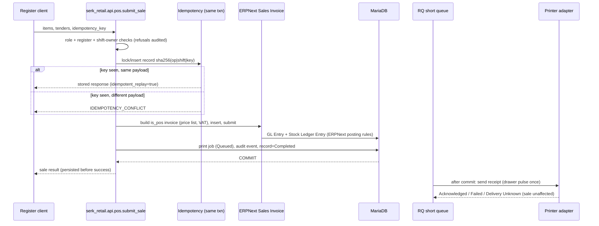

# SERK Retail architecture (M1 as built)

## Logical boundaries (one deployable Frappe app today)

| Boundary | M1 module | State |
|---|---|---|
| SERK Retail Core | `core/` (authz, audit, idempotency, errors), `setup/` | Built |
| SERK POS | `api/pos.py`, `core/receipts.py` | API built; cashier UI not built |
| Retail Operations | `api/inventory.py` (receiving) | Receiving only |
| Device Bridge | `devices/printer.py` (adapter contract + simulator) | Simulator only |
| Branch Continuity | — | Planned M2 |
| AI Gateway | — | Planned M5 |
| Analytics | `core/reconciliation.py` (operational check) | Minimal |

## M1 sequence — sale

## Failure paths covered in M1

| Failure | Behaviour | Test |
|---|---|---|
| Double click / retry / concurrent duplicate | One sale; replay returns original | test_02, test_04 |
| Key reuse with different basket | Rejected, nothing written | test_03 |
| Insufficient stock or validation error mid-sale | Whole transaction rolls back incl. idempotency record | test_10 |
| Printer paper-out / offline | Sale stays submitted; retry allowed; no second drawer pulse | test_08 |
| Printer timeout | Delivery Unknown; resend refused; COPY required | test_08 |
| Over-refund (sequential) | Refused with remaining quantity | test_05 |
| Over-refund (concurrent) | Serialized by `FOR UPDATE` on the original invoice | test_13 |
| Unauthorised approver / self-approval | Refused and audited | test_06 |

## Not built (explicitly)

Cashier UI, offline mode, hardware bridge, non-cash tenders, promotions explainability,
multi-branch governance, AI gateway, deployment artifacts beyond the dev script.
